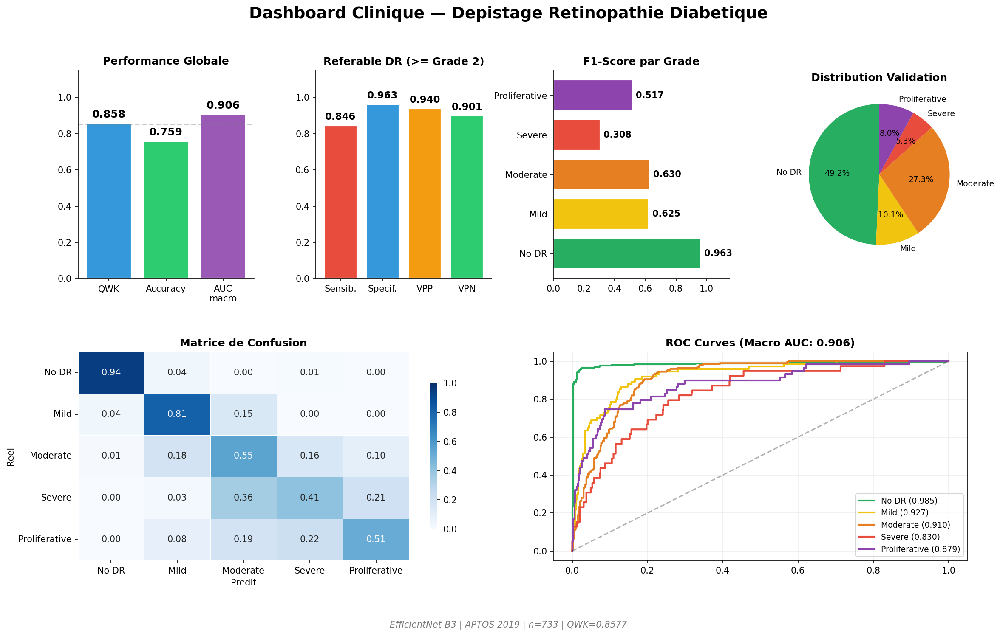
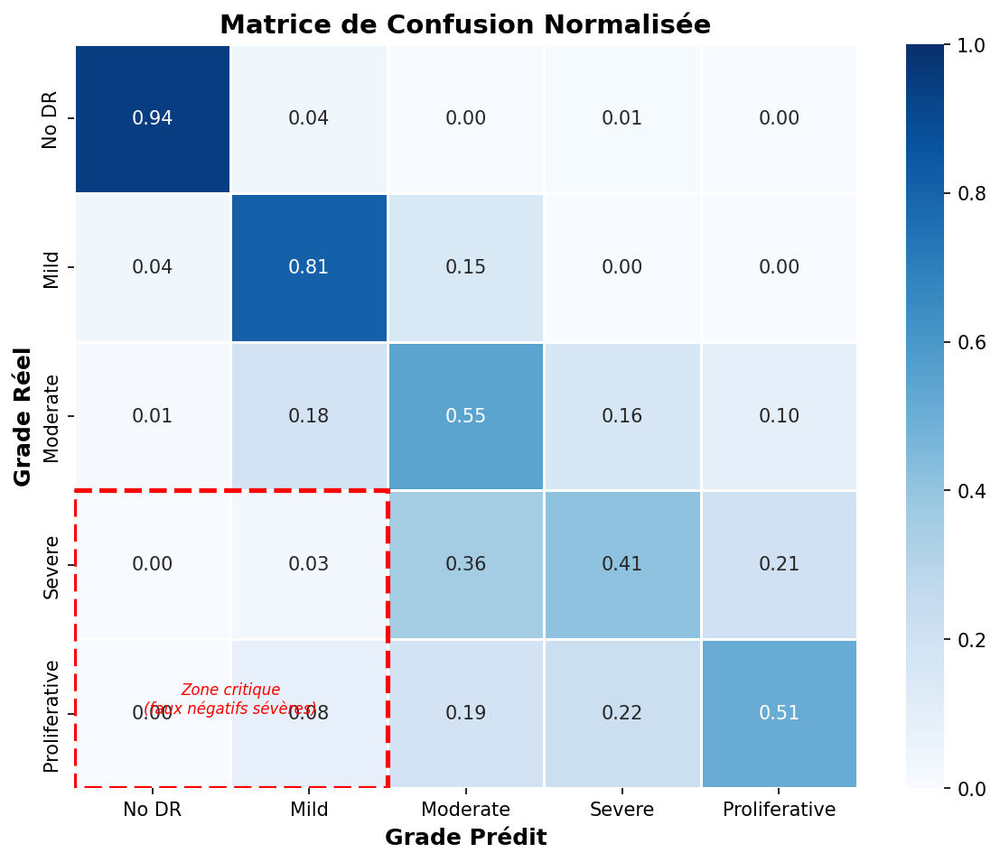

# Diabetic retinopathy grading from fundus photographs (EfficientNet-B3)

Five-grade classifier (No DR, Mild, Moderate, Severe, Proliferative) fine-tuned from ImageNet EfficientNet-B3, with a Grad-CAM heatmap, a referable-DR probability and a web demo.

> **Research prototype. Not a medical device. Not for clinical use.** Trained on a public dataset only; no patient data is included in this repository.

**Demo:** a Gradio app is in `demo/` (see Run it below). There is no hosted version yet.




## Results (validation split of APTOS 2019, 733 images)

| Metric | Value |
|---|---|
| Quadratic weighted kappa (QWK) | 0.858 |
| 5-class accuracy | 75.9% |
| Macro AUC (one-vs-rest) | 0.906 |
| Referable DR (grade 2 or higher): sensitivity | 84.6% |
| Referable DR: specificity | 96.3% |
| Referable DR: PPV / NPV | 94.0% / 90.1% |

Per-class AUC: No DR 0.985, Mild 0.927, Moderate 0.910, Severe 0.830, Proliferative 0.879. Full numbers in `results/results.json`; figures in `results/`.

## Method

- Data: APTOS 2019 Blindness Detection (3,662 labelled images), split 80/20 stratified by grade.
- Preprocessing: circular crop, Ben Graham colour normalisation and CLAHE, resized to 300 px (cached once to disk for speed).
- Model: EfficientNet-B3 (timm, ImageNet weights), dropout 0.4. Phase 1: 5 warm-up epochs with a frozen backbone. Phase 2: 25 epochs with the last 30% of the backbone unfrozen, cosine warm restarts.
- Imbalance (about 49% grade 0 vs 4% grade 3): class-weighted focal loss and mixup (alpha 0.4).
- Explainability: Grad-CAM.

## Limitations (read before quoting the numbers)

- The reported scores are on the validation split that was also used to pick the best epoch, and there is no separate test set. They are therefore optimistic.
- Single dataset from one programme (India); no external validation, and image quality and camera differ in other settings.
- Severe and Proliferative are the weakest grades (AUC 0.83 and 0.88) and are the rarest classes.
- An earlier run had a weight-initialisation problem on the output layer (Kaiming `fan_out` instead of `fan_in`), which gave unstable losses and a weaker result (QWK 0.77, accuracy 55%, macro AUC 0.85). It was fixed and the model retrained; the numbers above are from the fixed run.
- Grad-CAM shows where the network looked, not that it found a lesion.

## Run it

Train (Google Colab, free T4 GPU): open the training notebook and run all cells; it saves `best_dr_model.pth` and `results.json`.

Demo locally:

```bash
cd demo
pip install -r requirements.txt
# put best_dr_model.pth in this folder
python app.py
```

## Author

Abdullah Ghani, data and AI engineering student at ECE Paris.
